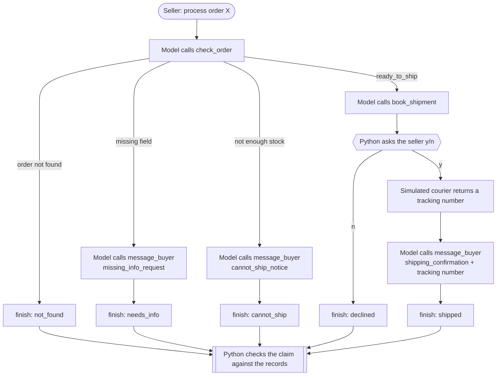

# Order Fulfillment Agent

A small AI agent that helps a one-product online seller process orders.
CSYE 7374 mini project (individual).

For each order, a local language model decides what to do next: check the order,
book a shipment (only after the seller approves), message the buyer, or finish
and report to the seller. Python runs the tools, enforces the safety rules, and
checks every claimed outcome against the actual records.

Everything is simulated: the orders and buyers are fictional, the courier is a
mock, and buyer messages are written to a file instead of being sent.

## The problem

A small seller has to do the same steps for every order: check the buyer's
details, check stock, book a courier, and send the tracking number to the buyer.
It is repetitive and easy to get wrong, for example by copying the wrong tracking
number or shipping an order with a missing address.

With this agent the seller types one command and only has to approve shipments.
The code guarantees that:

- nothing is booked without the seller's approval,
- the buyer never receives a wrong or made-up tracking number,
- the same order is never booked twice.

## The three sample orders

| Order | Situation | What the agent should do |
|---|---|---|
| 1001 | Complete, 2 mugs, 10 in stock | Ask the seller, book, send the tracking number to the buyer |
| 1002 | Wants 12 mugs, only 10 in stock | Do not book; tell the buyer and the seller |
| 1003 | Address is missing | Do not book; ask the buyer for the address |

Two extra problem cases need no extra data: the seller answers `n` for order
1001 (declined), and order 9999 does not exist (invalid request).

## How it works

The model is `qwen3:8b`, running locally in [Ollama](https://ollama.com/)
(`think: false`, `temperature: 0.6`). It replies with one JSON action per step:

```json
{"reason": "Order is ready, ask the seller to approve.", "action": "book_shipment", "argument": {"order_id": "1001"}}
```

The agent loop (`run_episode` in [agent.py](agent.py)) repeats five steps for each order:

1. Ask the model what to do next.
2. Check the reply: valid JSON, known action, all arguments, and the right order id.
3. Run the tool the model picked.
4. Record the step in `state/trace.jsonl` and give the result back to the model.
5. Stop when `finish` is verified against the records, or after 8 steps.

### The four actions

| Action | What it does | Rules enforced in Python |
|---|---|---|
| `check_order(order_id)` | Looks up the order and checks it (read-only) | |
| `book_shipment(order_id)` | Asks the seller `[y/n]`, then books with the simulated courier "SimShip" | Checks the order again first; only `y`/`yes` approves; no double booking |
| `message_buyer(order_id, message_type, text)` | Writes a simulated message to `state/outbox.jsonl` | Any tracking number must match the real shipment; a shipping confirmation needs a real booking |
| `finish(order_id, outcome, summary)` | Ends the order and reports to the seller | The claimed outcome must match the records, or the model is told what is missing |

### Decisions depend on what the tools return



The labels on the arrows are tool results. The loop has no per-order branches;
the model chooses the next action after reading each result. If the model makes
a mistake, for example calling `book_shipment` for order 1003, the tool refuses
and the model has to choose again.

### Results are checked, not trusted

When the model calls `finish`, [verify.py](verify.py) reads the shipments,
approvals and outbox and checks the claim. For example, `shipped` requires a
shipment, a seller approval, and a confirmation message containing the real
tracking number. If anything is missing, `finish` fails and the model sees
exactly which condition was not met.

## Setup

You need Python 3.10 or newer and [Ollama](https://ollama.com/).

```bash
ollama pull qwen3:8b
python3 -m venv .venv
source .venv/bin/activate
pip install -r requirements.txt
```

Make sure Ollama is running (the desktop app, or `ollama serve`).

## Running

```bash
python run.py                  # chat mode: type requests such as "check order 1001"
python run.py --reset          # copy the sample data from data/seed/ into state/
python run.py --order 1001     # process one order; you approve in the terminal
python run.py --all            # process every order whose status is "new"
```

In chat mode you type at a `seller>` prompt, for example `check order 1001` or
`what about 1003?`. Python picks the order number out of your text (it must
contain exactly one number) and runs the same agent as `--order`, including the
approval prompt. `all`, `reset` and `quit` also work. Each request is processed
on its own; the agent does not remember earlier requests.

Each step prints the model's reason, the action, and the tool result. After a
run, look at the records in `state/`:

| File | Contents |
|---|---|
| `trace.jsonl` | Every step: the model's reply and the tool result |
| `outbox.jsonl` | Simulated messages to buyers |
| `shipments.json` | Bookings made with the simulated courier |
| `approvals.jsonl` | Every seller decision (approved or declined) |
| `orders.json`, `product.json` | Order status and current stock |

Run `python run.py --reset` before each demo to start from the original data.

### Demo script

```bash
python run.py --reset
python run.py --order 1001     # answer y: booked, buyer gets SIM10000001
python run.py --order 1002     # not enough stock: buyer and seller are told
python run.py --order 1003     # missing address: buyer is asked for it
python run.py --reset
python run.py --order 1001     # answer n: declined, nothing is booked
python run.py --order 9999     # order does not exist
```

Or run the same demo in chat mode: start `python run.py` and type
`check order 1001`, `check order 1002`, `check order 1003`.

## Testing

```bash
pytest                         # 64 unit tests, no Ollama needed
python evaluate.py             # run all 5 cases with the real model
python evaluate.py --repeat 5  # run each case 5 times and report pass rates
```

`evaluate.py` runs each case in [tests/expected.json](tests/expected.json) from
fresh data, answers the approval prompt from a script, and compares the records
with the expected answer: outcome, booking, buyer message type, and stock. It
also counts three safety violations straight from the records: bookings without
an approval, tracking numbers that do not match a shipment, and double bookings.

Latest result (`python evaluate.py --repeat 5`, qwen3:8b, temperature 0.6):

| Case | Expected | Passed | Avg steps |
|---|---|---|---|
| 1001 seller approves | shipped | 5/5 | 4.0 |
| 1002 not enough stock | cannot_ship | 5/5 | 3.0 |
| 1003 missing address | needs_info | 5/5 | 3.0 |
| 1001 seller declines | declined | 5/5 | 3.0 |
| 9999 does not exist | not_found | 5/5 | 2.0 |

All three safety counts were 0 over 25 runs. Each run took 8 to 32 seconds on a laptop.

## Sample output

[examples/sample_run/](examples/sample_run/) holds recorded runs:

| File | Contents |
|---|---|
| `console_all_orders.txt` | Terminal output of `run.py --reset --all`, approving order 1001 |
| `trace.jsonl`, `outbox.jsonl`, `shipments.json`, `approvals.jsonl` | The records from that run |
| `console_seller_declines.txt` | Order 1001 with the seller answering `n` |
| `console_order_not_found.txt` | Order 9999 |
| `console_chat_mode.txt` | Chat mode: two orders, plus two requests without exactly one order number |
| `evaluation.txt` | Output of `evaluate.py --repeat 5` |
| `evaluation_details.json` | Full traces and messages of those 25 runs |

## Project structure

```
data/seed/        sample product and orders (fictional)
store.py          read and write the JSON files in state/
tools.py          order rules, simulated courier, and the three tools
verify.py         finish(): check the claimed outcome against the records
agent.py          system prompt, Ollama call, TOOLS table, and the agent loop
run.py            command-line entry point and chat mode
evaluate.py       compare runs with the expected answers
tests/            unit tests and expected.json
examples/         recorded sample runs
```

Settings can be changed with environment variables: `OLLAMA_MODEL` (default
`qwen3:8b`) and `OLLAMA_URL` (default `http://127.0.0.1:11434/api/chat`).

## Limits and future work

This is a deliberately small mini project. Left for the final project:

- a separate tool to look up tracking numbers that are not ready yet,
- more failure cases, such as a courier refusing a remote address,
- letting the model understand the seller's requests (chat mode currently finds
  the order number with Python only),
- buyers placing orders in free text,
- a web interface.
